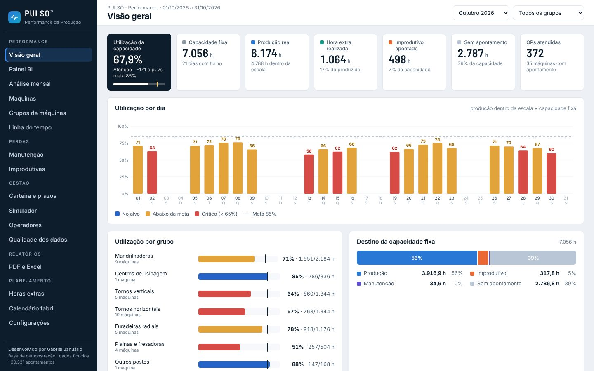
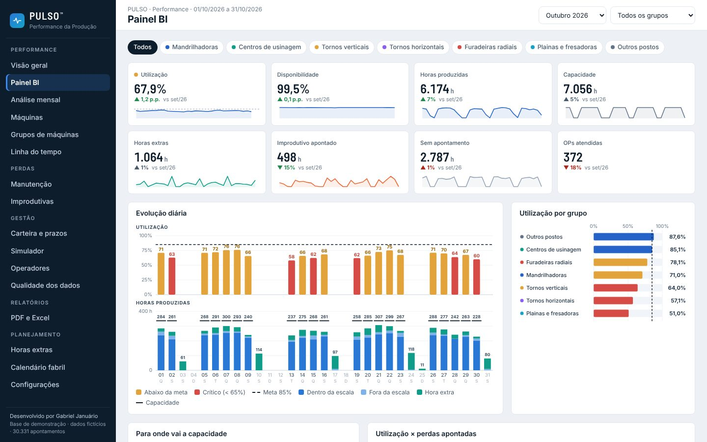
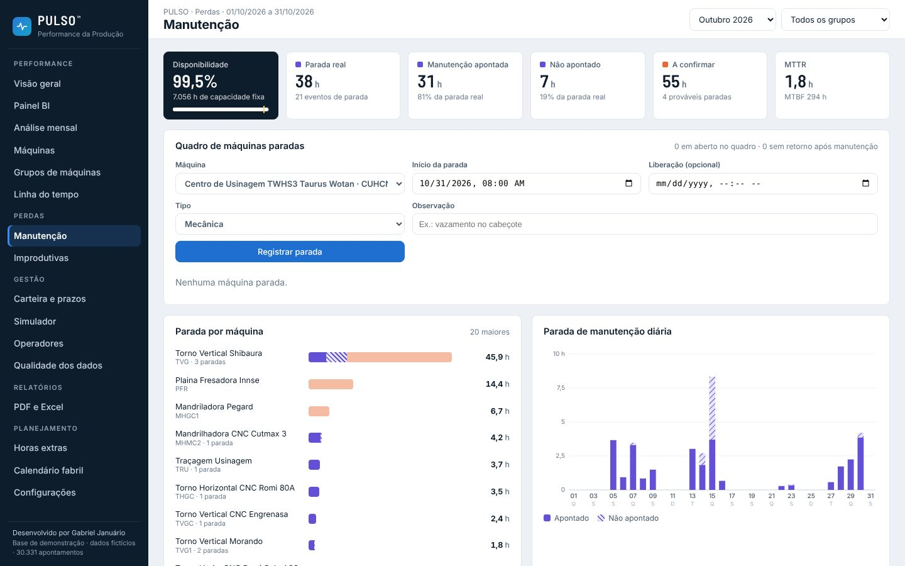
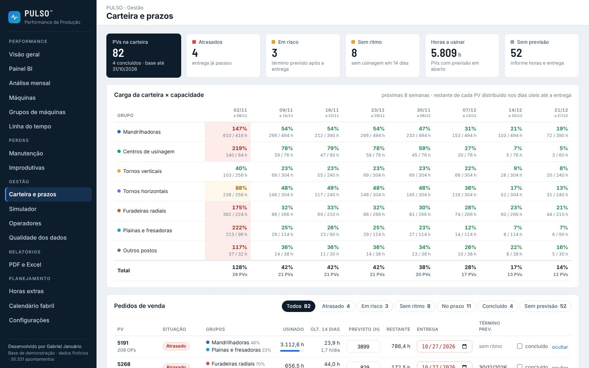
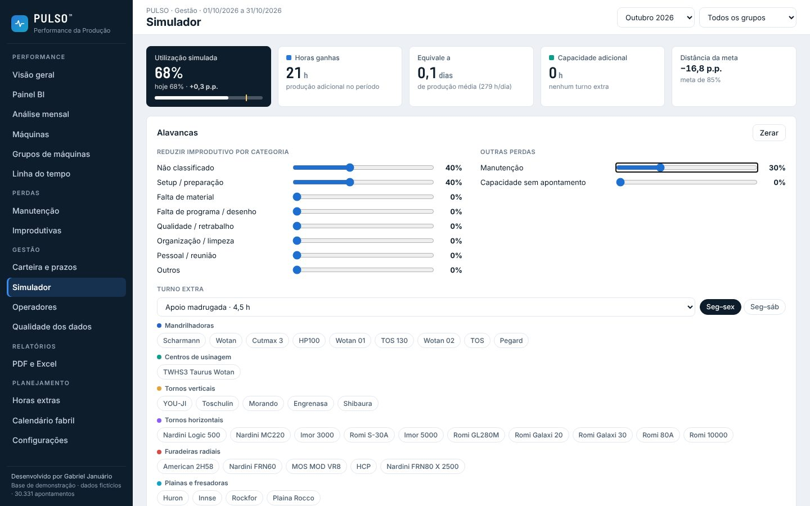
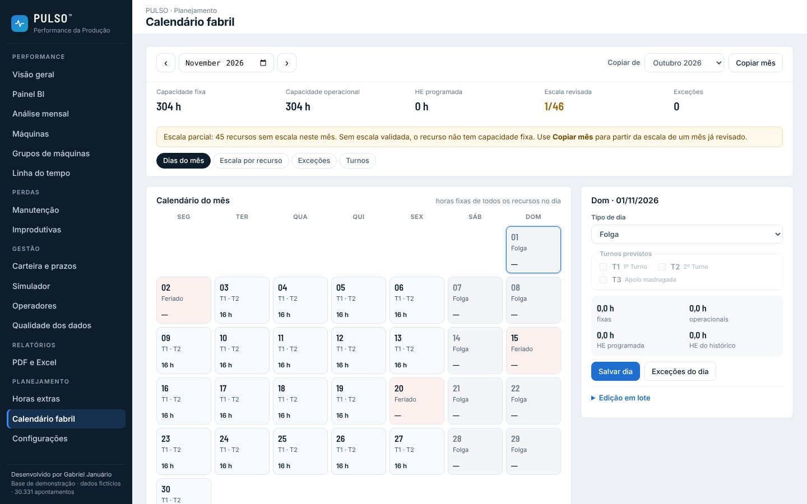
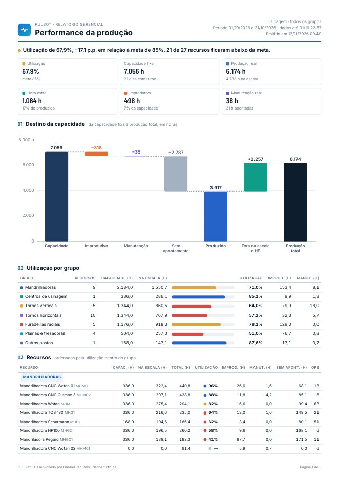

<div align="center">

# PULSO™ — Performance da Produção

**Utilização, capacidade e perdas de um parque de usinagem, calculadas a partir dos apontamentos do ERP.**

**[Abrir a demonstração →](https://gabriel-januario.github.io/pulso/)**

React · TypeScript · SQLite no navegador · 86 testes automatizados · base de demonstração transformada

</div>



---

## Roteiro de demonstração

**Decisão de PPCP:** identificar qual grupo de máquinas investigar antes da próxima reunião de carga.

1. Na **Visão geral**, selecione outubro de 2026 e todos os grupos. Nesse cenário, a utilização é de **67,9%** para toda a usinagem e **51,0%** em planas e fresadoras.
2. No **Painel BI**, filtre planas e fresadoras. Compare as máquinas e a evolução diária para localizar o recurso e o dia que mais merecem investigação.
3. Cruze os motivos de parada com o calendário e a qualidade dos registros. Horas sem apontamento sinalizam uma lacuna de informação. Confirme com a operação se houve falta de cobertura, falta de carga ou falha de registro antes de atribuir uma causa.

A decisão proposta para a reunião é escolher o recurso que será investigado, confirmar a causa com a produção e definir o responsável pela ação. Os números ilustram a base de demonstração.

## Por que eu construí o PULSO

Trabalho com planejamento e operações industriais. Na usinagem, a pergunta central da gestão é simples —
*"quanto da nossa capacidade estamos usando de verdade?"* — e, sem uma ferramenta, respondê-la exige horas de
planilha a cada fechamento.

Os dados existiam. Cada operador aponta no coletor o início, o fim, a OP e a operação. O problema é que o
apontamento bruto não responde à pergunta de gestão, por quatro motivos que a rotina da usinagem deixa claros:

1. **Capacidade não é 24 horas.** Depende dos turnos de cada máquina, do calendário (feriados, pontes, sábados
   convocados) e da escala do mês. Uma máquina parada num turno que ela não tem não é perda.
2. **O dia da fábrica não é o dia do calendário.** O segundo turno termina de madrugada; um apontamento das
   02:00 pertence ao dia produtivo anterior. No PULSO, o dia vai das 06:00 às 06:00.
3. **Horas apontadas não são horas de máquina.** Dois operadores na mesma mandrilhadora não dobram a produção
   da máquina. A produção real é a união dos intervalos, não a soma.
4. **A manutenção some do apontamento.** O operador aponta a quebra e vai ajudar em outra máquina. A máquina
   continua parada até o próximo apontamento produtivo — e esse tempo precisa aparecer.

O PULSO transforma os apontamentos nessas respostas: utilização por dia, máquina e grupo; para onde vai cada
hora de capacidade; quais motivos concentram as perdas; e quais máquinas puxam o resultado para baixo.

## O que o sistema mostra

| Tela | Pergunta que responde |
|---|---|
| **Visão geral** | Como está o mês? Quais grupos estão abaixo da meta? |
| **Painel BI** | Onde exatamente está a perda? Filtro cruzado por grupo, máquina e dia, comparação com o período anterior |
| **Análise mensal** | Estamos melhorando? Visão por mês, trimestre ou ano, com memória de cálculo exportável |
| **Máquinas** | O que aconteceu nesta máquina, dia a dia, OP a OP? |
| **Grupos de máquinas** | A média do grupo esconde máquinas com problema? |
| **Linha do tempo** | Quem estava produzindo o quê, a cada hora? Quais pedidos consumiram mais máquina? |
| **Manutenção** | Qual é a disponibilidade real? Quanto da parada não foi apontado? Quais máquinas estão paradas agora? |
| **Improdutivas** | Quais motivos concentram as perdas? Quais máquinas e operadores são mais afetados? |
| **Carteira e prazos** | Quais pedidos vão atrasar no ritmo atual? Qual grupo de máquinas fica sobrecarregado nas próximas semanas? |
| **Simulador** | Quanto a utilização sobe se reduzirmos uma perda, ou se abrirmos um turno em algumas máquinas? |
| **Operadores** | Como cada pessoa aponta? Onde há registros esquecidos abertos ou sobrepostos? |
| **Qualidade dos dados** | Dá para confiar nos números deste período? Onde o registro tem lacunas? |
| **Horas extras** | Quanta HE foi realizada, em quais recursos? O que está programado para o mês? |
| **Calendário fabril** | Quais dias e turnos contam como capacidade? Quem cobre cada recurso no mês? Que exceções aconteceram? |
| **Relatórios** | Documento A4 pronto para PDF (performance, perdas, horas extras, carteira) e planilha Excel com fórmulas auditáveis |
| **Configurações** | Metas, regras de manutenção, cadastro de máquinas, motivos de parada e backup da configuração |

Os filtros ficam na URL (`#/painel?p=2026-10&g=Mandrilhadoras&m=MHMC`): um recorte pode ser enviado por link.

### Algumas telas

| | |
|---|---|
|  **Painel BI**: filtro cruzado e comparação com o período anterior |  **Manutenção**: tempo parado, médias por evento e quadro de máquinas paradas |
|  **Carteira e prazos**: término previsto pelo ritmo real e carga das próximas semanas |  **Simulador**: quanto a utilização sobe recuperando perdas ou abrindo um turno |
|  **Calendário fabril**: dias, turnos, escala e exceções que definem a capacidade |  **Relatório em PDF**: A4, texto selecionável, mesmas contas das telas |

## Regras de negócio

As definições abaixo são o coração do projeto. O detalhamento, com exemplos, está em
[`docs/REGRAS-DE-NEGOCIO.md`](docs/REGRAS-DE-NEGOCIO.md).

| Indicador | Definição |
|---|---|
| **Capacidade fixa** | Horas líquidas dos turnos validados na escala do mês, nos dias úteis do calendário fabril, multiplicadas pela disponibilidade cadastrada da máquina |
| **Produção real** | União dos intervalos apontados — apontamentos simultâneos na mesma máquina contam uma vez |
| **Utilização** | Produção dentro da capacidade fixa ÷ capacidade fixa. Hora extra não infla a utilização |
| **Hora extra realizada** | Produção em janelas de HE lançadas ou, no histórico, produção além da jornada líquida do dia |
| **Destino da capacidade** | Cada minuto de capacidade fixa recebe exatamente um destino: manutenção, sem cobertura, produção, improdutivo, sem programação ou sem apontamento. A soma fecha em 100% |
| **Parada de manutenção** | Abre no apontamento de manutenção e só fecha no próximo apontamento produtivo da máquina (limite de 5 dias). O tempo real é a capacidade de turno dentro desse intervalo |
| **Status** | No alvo ≥ 85% · atenção entre 65% e 85% · crítico < 65% (configurável) |

### Como ler os dois números de produção

Na visão geral de outubro de 2026, o cartão indica cerca de **4.788 h dentro da escala**. Esse valor mede a produção apontada dentro dos turnos regulares e compõe o cálculo de utilização. A faixa **Destino da capacidade fixa** atribui **3.916,9 h à produção alocada** no mesmo recorte. Ela distribui as horas líquidas da capacidade por destino e aplica a prioridade de manutenção e falta de cobertura antes de atribuir horas à produção.

A diferença de aproximadamente **871 h** resulta desses critérios. Consulte a [distribuição de capacidade no motor de cálculo](src/engine/core.ts) e as [definições dos indicadores](docs/REGRAS-DE-NEGOCIO.md) ao comparar os valores.

A carteira trabalha em horas-máquina. Consolida sobreposições dentro do mesmo pedido e recurso e soma o trabalho em recursos diferentes. Quando o realizado atinge as horas previstas, o pedido fica em **Validar saldo** até a conclusão ser confirmada. A carga futura usa capacidade operacional do calendário e da escala. Uma escala pendente pode usar a média histórica como estimativa. As horas previstas da demo são ilustrativas, e a projeção não considera a sequência de operações nem reserva recursos.

## Arquitetura

```
public/pulso.db ──► src/db ──────► src/engine ──────► src/analytics ──────► src/app
SQLite (30 mil       sql.js +       motor de           cálculos de cada       React +
apontamentos)        consultas SQL  indicadores        tela, funções puras    SVG próprio
```

- **Sem servidor.** O banco SQLite é baixado e consultado no próprio navegador com
  [sql.js](https://sql.js.org) (SQLite compilado para WebAssembly). A demo roda em qualquer hospedagem estática.
- **Motor de indicadores isolado da interface.** `src/engine` recebe a base e a configuração e devolve números;
  não conhece React nem o DOM. Cada instância tem seu próprio estado — nada global.
- **Cálculo de tela separado de desenho.** `src/analytics` reúne funções puras (filtro cruzado, pareto, cascata,
  séries mensais, OPs, pedidos). São elas que os testes validam.
- **Gráficos em SVG escritos à mão**, medidos pela largura real do contêiner: o texto nunca é escalado e nenhum
  rótulo é desenhado se não couber.

As decisões de arquitetura, com alternativas consideradas, estão em [`docs/ARQUITETURA.md`](docs/ARQUITETURA.md).

## Qualidade

A versão 2.2 do PULSO era um único arquivo HTML de 4.800 linhas, usado no dia a dia. Reescrever um sistema que
já está em uso tem um risco claro: mudar um número sem perceber. Por isso, antes de migrar cada tela, capturei os
resultados da v2.2 e transformei em teste.

```
npm test
 ✓ tests/engine.test.ts       paridade com a v2.2 em 5 recortes: totais, cada máquina, grupos, cada dia
 ✓ tests/dashboard.test.ts    filtro cruzado e período de comparação idênticos à v2.2; regras dos visuais
 ✓ tests/views.test.ts        baixo desempenho, pedidos, OPs e análise mensal idênticos à v2.2
 ✓ tests/losses.test.ts       manutenção (médias por evento, paradas a confirmar) e improdutivos idênticos à v2.2
 ✓ tests/management.test.ts   regras da carteira e carga futura; paridade do simulador, operadores e qualidade
 ✓ tests/reports.test.ts      o Excel gerado fecha com o motor: capacidade, produção, dias e pareto
 ✓ tests/planning.test.ts     capacidade do mês, HE realizada e programada, cópia de mês e escala idênticas à v2.2
 ✓ tests/engine-units.test.ts intervalos, datas e saneamento/migração da configuração
 ✓ tests/db.test.ts           integridade referencial, consultas SQL e carteira de demonstração
 ✓ tests/config-backup.test.ts validação da importação e recuperação de dados locais
 Tests  86 passed
```

Além da paridade, há testes de invariantes de negócio: o destino da capacidade soma exatamente a capacidade;
a cascata fecha; o pareto soma 100%; as horas distribuídas por hora do dia batem com os apontamentos.
A integração contínua (`.github/workflows/ci.yml`) roda checagem de tipos, testes e build a cada push.

O enquadramento também foi verificado de forma automatizada: cada tela foi aberta em 1440, 1280 e 390 px de
largura, procurando texto cortado, rótulo de gráfico fora do desenho e rolagem horizontal da página. Os
relatórios em PDF foram gerados e conferidos página a página.

## Como este projeto foi construído

O PULSO é fruto de uma colaboração entre mim e IA, e eu faço questão de deixar isso claro.

**O que é meu:** o problema, o conhecimento do processo e todas as regras de negócio — o dia produtivo de 06:00
a 06:00, a forma de tratar apontamentos simultâneos, a regra que mantém a máquina parada até o próximo
apontamento produtivo, a ideia de mostrar a utilização "sem o destaque" para revelar médias enganosas, o
desenho de cada tela a partir das perguntas que a gestão faz. Também é minha a validação: os critérios de cada
indicador e, nesta versão, a exigência de que todo número continue idêntico ao da versão anterior.

**Onde usei IA:** usei o Claude (Anthropic) como par de programação — para escrever e refatorar código, montar a
estrutura em React e TypeScript, escrever testes a partir dos critérios que defini e revisar o enquadramento
das telas. Os commits feitos nessa parceria trazem a linha `Co-Authored-By`.

Essa divisão é, na minha visão, o jeito certo de usar IA em transformação digital: quem conhece o processo
decide *o que* precisa ser verdade; a IA acelera o *como*; e testes garantem que o resultado continua correto.

## Rodar localmente

Requer Node 22 ou mais recente.

```bash
npm ci
npm run dev        # http://localhost:5173
npm test           # 78 testes
npm run build      # gera dist/ (site estático)
```

## Estrutura

```
db/              modelo de dados (schema.sql) e cadastros em CSV
public/pulso.db  base de demonstração
src/db/          abertura do banco e consultas SQL
src/engine/      motor de indicadores (regras de negócio), TypeScript estrito
src/reports/     construtor da planilha Excel
src/analytics/   cálculos das telas — funções puras e testadas
src/app/         telas, componentes e gráficos em React
tests/           testes automatizados e valores de referência da v2.2
docs/            regras de negócio e decisões de arquitetura
legacy/          PULSO v2.2, a versão de referência dos testes de paridade
```

## Roteiro

- [x] Banco de dados e camada de consultas
- [x] Motor de indicadores isolado e testado contra a v2.2
- [x] Visão geral · Painel BI · Análise mensal · Máquinas · Grupos · Linha do tempo
- [x] Manutenção (com quadro de máquinas paradas) e Improdutivas
- [x] Carteira e prazos · Simulador de capacidade · Operadores · Qualidade dos dados
- [x] Horas extras · Calendário fabril · Configurações
- [x] Relatórios em PDF e Excel
- [x] Núcleo do motor em TypeScript estrito, separado em calendário, intervalos, configuração e base
- [x] Demonstração publicada no GitHub Pages, atualizada a cada push na `main` com os testes verdes

## Sobre os dados

A base de demonstração foi derivada de uma exportação real e passou por transformação. O arquivo SQLite é público, assim como os cadastros e a referência legada versionados neste repositório. Esta transformação não é uma garantia de anonimização irreversível. Use uma base sintética ou explicitamente liberada para publicação ao reproduzir a demonstração com outros dados. Os nomes de operadores e logins foram substituídos por valores inventados. Chapas, OPs, pedidos e centros de custo foram renumerados. Horários e durações foram alterados. A Metalúrgica Horizonte S.A. é uma empresa fictícia. As horas previstas e datas de entrega da carteira foram geradas para ilustrar situações de planejamento.

---

Desenvolvido por **Gabriel Januário** · Planejamento e Operações Industriais · Melhoria de Processos · Dados e Digitalização

© 2026 Gabriel Januário
